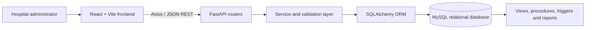
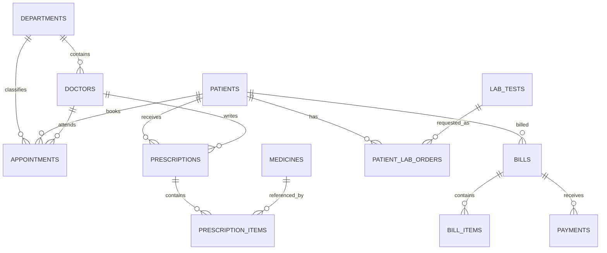

# Hospital Patient & Appointment Management System

A DBMS capstone project scaffold for hospital administration, built with React + Vite, FastAPI, SQLAlchemy and MySQL. Implementation order follows the requested sequence: **backend first, frontend second, database initialization/SQL deliverables third**. ORM models and SQL design are prepared together so names stay consistent.

## Problem statement
Hospitals manage patients, doctors, departments, appointments, prescriptions, laboratory tests, bills and payments. Disconnected records can create duplicate data, scheduling conflicts, inconsistent histories and billing mistakes. This project centralizes those workflows around a relational database and API.

## Folder structure
```text
DBMS_capstone/
├── Backend/       # FastAPI, SQLAlchemy models, services, routers, SQL scripts, tests
├── Frontend/      # React + Vite dashboard
├── .gitignore
└── README.md
```

## Architecture


## ER diagram


## Normalization notes (3NF target)
- Each table has a primary key and stores attributes for one entity or relationship.
- Doctor department details live in `departments`, not repeated in every doctor row.
- Prescriptions and medicines use `prescription_items` for their many-to-many relationship.
- Bills and payments are separate so multiple partial payments can be recorded.
- Patient, doctor, department, medicine and lab catalogue data are referenced by foreign keys rather than copied into transaction rows.

## Development setup

### 1. Backend first
```powershell
cd Backend
python -m venv .venv
.venv\Scripts\Activate.ps1
pip install -r requirements.txt
Copy-Item .env.example .env
```
Configure `DATABASE_URL` in `Backend/.env`. Continue with the database initialization below before starting data endpoints. Run `uvicorn app.main:app --reload --port 8000`; Swagger docs are at `http://localhost:8000/docs`.

### 2. Frontend second
```powershell
cd Frontend
Copy-Item .env.example .env
npm install
npm run dev
```
Frontend URL: `http://localhost:5173`. The API base URL is configured through `VITE_API_BASE_URL`.

### 3. Database initialization third
Install/start MySQL 8+, then execute scripts from a MySQL client in this order:
1. `Backend/sql/01_schema.sql`
2. `Backend/sql/02_constraints_indexes.sql`
3. `Backend/sql/03_views.sql`
4. `Backend/sql/04_procedures.sql`
5. `Backend/sql/05_triggers.sql`
6. `Backend/sql/06_seed_data.sql`
7. `Backend/sql/07_reports.sql` (report queries are run selectively, not as persistent objects)

The seed script uses fictional/demo data only. SQL schema scripts create the full target relational structure. SQLAlchemy metadata currently covers the operational patient/doctor/department/appointment subset.

## API overview
| Method | Endpoint | Purpose |
|---|---|---|
| GET | `/api/health` | API and DB health |
| GET, POST | `/api/patients` | List/search and create patients |
| GET, PUT, DELETE | `/api/patients/{id}` | Read, update, deactivate patient |
| GET, POST | `/api/doctors` | List/filter and create doctors |
| GET, POST | `/api/departments` | List and create departments |
| GET, POST | `/api/appointments` | List/filter and book appointment |
| GET | `/api/appointments/{id}` | Appointment detail |
| PATCH | `/api/appointments/{id}/status?status=cancelled` | Update status |
| GET | `/api/dashboard/stats` | Live dashboard counts and recent appointments |

## SQL concepts demonstrated
Primary/foreign keys, unique and check constraints, indexes, joins, left joins, aggregate functions, grouping, HAVING, subqueries, EXISTS/NOT EXISTS, CASE, date functions, CTEs, views, stored procedures, triggers and audit logging.

## Testing
From `Backend/`, activate the virtual environment and run `pytest`. Only schema validation tests are included at this milestone; API integration tests need a dedicated isolated MySQL test database. Do not treat a passing schema test as proof that every endpoint or SQL script has been verified.

## Current implementation status and limitations
- Implemented: FastAPI setup, MySQL environment configuration, ORM models for departments/doctors/patients/appointments, schemas, patient CRUD, doctor/department create/list, appointment booking/list/detail/status, dashboard statistics, React dashboard and patient CRUD UI, SQL target schema and DBMS scripts.
- Scaffolded but not yet implemented as backend CRUD APIs: prescriptions, medicines/inventory batches, laboratory orders/results, billing and payments. Their SQL tables and frontend listing pages are present, but those pages will report an API error until routes are added.
- The appointment overlap check prevents normal conflicting bookings, but simultaneous booking race conditions need a stronger MySQL locking strategy before production use.
- No authentication/role-based authorization is implemented. This is a university demo, not a production medical system.
- SQL stored procedures/triggers and all scripts have not been executed against a live MySQL server in this environment. Validate them in your local MySQL version before submission.

## Future enhancements
Implement remaining modules and role-based access; add isolated integration tests; implement concurrency-safe appointment locking; add audit review screens, pagination controls, laboratory result authorization, and bill/payment transactions; then conduct end-to-end verification.
